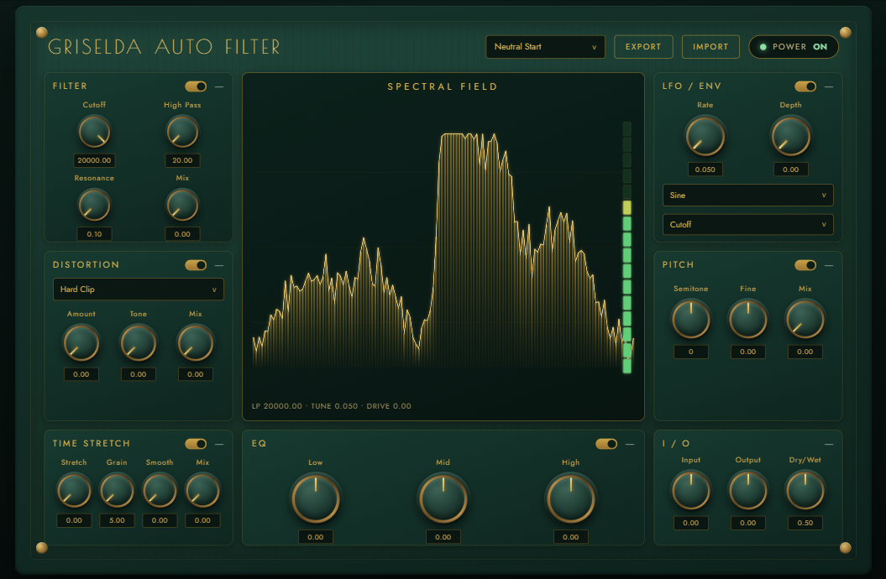
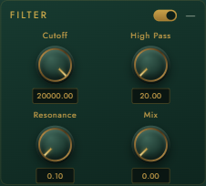
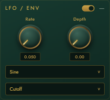
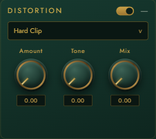
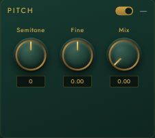
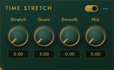
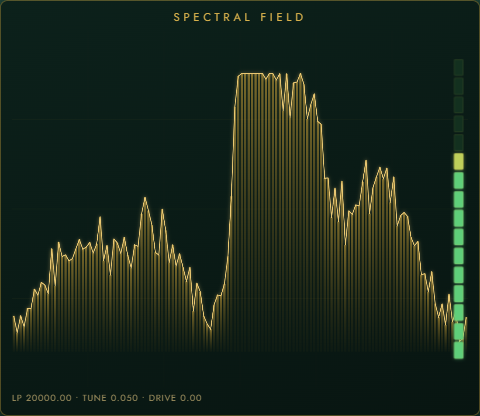

<p align="center">
  
</p>

<p align="center"><b>Ein Lo-Fi-Autofilter für Hip-Hop-Produktionen, als VST3 und Standalone für Windows</b><br>
Filter, EQ, LFO und Hüllkurve, vier Arten Verzerrung, Pitch und Grain-Timestretch in einer dunkelgrünen Box</p>

<p align="center">
  <a href="https://github.com/sog-maker/griselda-auto-filter-plugin/releases/latest"></a>
  <a href="LICENSE"></a>
  
  
</p>

<p align="center"><b>Neu in 2.2.3:</b> die erste öffentliche Version, mit WebView-Oberfläche, fünf Werks-Presets sowie Export und Import von Presets ·
<a href="https://github.com/sog-maker/griselda-auto-filter-plugin/releases/tag/v2.2.3">die Release Notes</a></p>

<p align="center"><b>Neu bei Griselda?</b> Lies die <a href="docs/manual/GUIDE.de.md">Anleitung</a> und die
<a href="INSTALL.de.md">Installationsanleitung</a>.<br>
<b>English:</b> <a href="README.md">README in English</a></p>



Griselda Auto Filter ist ein Effekt für staubige Loops, dunkle Samples und bewegte Basslines. Im Kern sitzt ein
resonanter Tiefpass- und Hochpassfilter. Ein LFO und ein Hüllkurvenfolger bewegen Cutoff, Resonanz, Tonhöhe oder Drive.
Nach dem Filter folgen ein Drei-Band-EQ, vier Arten Verzerrung mit Klangregler, ein Pitch-Shifter und ein
Grain-Timestretch, jeweils mit eigenem Mix-Regler und eigenem Schalter. Ein Spektralfeld zeigt, was hereinkommt.

Gebaut ist es mit [JUCE 8](https://juce.com). Die Oberfläche ist in React geschrieben und läuft in Microsoft WebView2
im Plug-in-Fenster. Fehler und Ideen bitte [hier](https://github.com/sog-maker/griselda-auto-filter-plugin/issues)
melden.

## Installieren

1. Das Windows-Zip aus dem [neuesten Release](https://github.com/sog-maker/griselda-auto-filter-plugin/releases/latest)
   laden und entpacken.
2. Die DAW schließen.
3. `Griselda Auto Filter.vst3` nach `C:\Program Files\Common Files\VST3` kopieren (dafür braucht es
   Administratorrechte).
4. Die DAW starten, nach neuen Plug-ins suchen lassen und **Griselda Auto Filter** auf eine Spur legen.

**Standalone:** `Griselda Auto Filter.exe` starten und unter *Options* das Audiogerät wählen.

**Für ein scharfes Bild in Ableton Live:** mit der rechten Maustaste auf die Titelleiste des Geräts klicken,
**Auto-Skalierung Plug-in-Fenster** ausschalten und das Plug-in neu laden.

**WebView2:** Die Oberfläche braucht die Microsoft Edge WebView2 Runtime. Windows 11 hat sie; unter Windows 10 bei
leerem Fenster von [Microsoft](https://developer.microsoft.com/microsoft-edge/webview2/) installieren.

**Deinstallieren:** `Griselda Auto Filter.vst3` aus dem VST3-Ordner löschen.

Schritt für Schritt: [INSTALL.de.md](INSTALL.de.md) · [English](INSTALL.md).

## Auf einen Blick

| | |
| --- | --- |
| **Formate** | VST3, Standalone-Programm |
| **Plattform** | Windows 10 und 11, x64 (macOS aus dem Quellcode, ungetestet) |
| **Getestet in** | Ableton Live 12 |
| **Signalweg** | Eingang → Filter → EQ → Distortion → Pitch → Time Stretch → Ausgang, dann Dry/Wet |
| **Filter** | Tiefpass 20 Hz bis 20 kHz, Hochpass 20 Hz bis 1,5 kHz, Resonanz, Mix |
| **Modulation** | LFO mit fünf Formen und vier Zielen, Hüllkurvenfolger auf dem Cutoff |
| **Distortion** | Soft Clip, Hard Clip, Tube, Foldback; Amount, Tone, Mix |
| **Pitch** | ±24 Halbtöne, ±100 Cent, Mix |
| **Time Stretch** | zwei überlappende Grains, 5 bis 250 ms, Smooth, Mix |
| **EQ** | Low Shelf, Mid Peak, High Shelf, ±12 dB |
| **Presets** | fünf Werks-Presets, Export und Import als XML |
| **Fenster** | 704 × 461 Punkte, feste Größe |
| **Automation** | alle Parameter, auch einige, die nicht auf der Oberfläche liegen |

## Ein Rundgang

### Den Klang mit dem Filter formen

<table>
<tr>
<td width="40%"><br><sub><b>FILTER</b>: Tiefpass, Hochpass, Resonanz, Mix</sub></td>
<td>

1. **Cutoff** schließt den Tiefpass von 20 kHz bis hinunter auf 20 Hz.
2. **High Pass** nimmt die Tiefen weg, von 20 Hz bis 1,5 kHz.
3. **Resonance** hebt die Frequenzen um den Cutoff an.
4. **Mix** mischt das gefilterte mit dem ungefilterten Signal. Bei 0 ist der Filter nicht zu hören.
5. Der **Schalter** im Kopf schaltet den Bereich ein und aus.

</td>
</tr>
</table>

### Bewegung hineinbringen

<table>
<tr>
<td width="40%"><br><sub><b>LFO / ENV</b>: Rate, Depth, Form, Ziel</sub></td>
<td>

1. **Rate** stellt das Tempo des LFO ein, von 0,05 Hz bis 20 Hz.
2. **Depth** bestimmt, wie weit er das Ziel bewegt.
3. Ein Klick auf das **Formfeld** wechselt zwischen Sinus, Dreieck, Sägezahn, Rechteck und Zufall.
4. Ein Klick auf das **Zielfeld** wählt Cutoff, Resonanz, Pitch oder Distortion.
5. Der Hüllkurvenfolger öffnet den Cutoff mit dem Pegel des Eingangs. Stärke, Attack, Release und Empfindlichkeit
   sind Automationsparameter in der DAW.

</td>
</tr>
</table>

### Dreck dazugeben

<table>
<tr>
<td width="40%"><br><sub><b>DISTORTION</b>: Art, Amount, Tone, Mix</sub></td>
<td>

1. Ein Klick auf das **Artfeld** wählt Soft Clip, Hard Clip, Tube oder Foldback.
2. **Amount** treibt das Signal in die Verzerrung.
3. **Tone** öffnet einen Tiefpass hinter der Verzerrung, von dunkel (700 Hz) bis hell (14 kHz).
4. **Mix** mischt es mit dem sauberen Signal.

</td>
</tr>
</table>

### Die Tonhöhe biegen

<table>
<tr>
<td width="40%"><br><sub><b>PITCH</b>: Semitone, Fine, Mix</sub></td>
<td>

1. **Semitone** verschiebt die Tonhöhe um bis zu zwei Oktaven nach oben oder unten.
2. **Fine** verstimmt um bis zu 100 Cent.
3. **Mix** mischt das verschobene mit dem ursprünglichen Signal. Wenig Mix ergibt eine dicke, verstimmte Schicht.

</td>
</tr>
</table>

### Die Zeit verschmieren

<table>
<tr>
<td width="40%"><br><sub><b>TIME STRETCH</b>: Stretch, Grain, Smooth, Mix</sub></td>
<td>

1. **Stretch** liest kleine Stücke der jüngsten Vergangenheit langsamer ab.
2. **Grain** stellt die Länge der Stücke ein, von 5 bis 250 ms.
3. **Smooth** lässt die Grains stärker überlappen und macht das Ergebnis weicher.
4. **Mix** mischt die Textur mit dem Signal.

</td>
</tr>
</table>

### Sehen, ausbalancieren, speichern

<table>
<tr>
<td width="40%"><br><sub><b>SPECTRAL FIELD</b>: das Spektrum des Eingangs und eine Pegelanzeige</sub></td>
<td>

1. Das **Spektralfeld** zeigt das Spektrum des Eingangs und eine Pegelanzeige. Ohne Signal zeigt es eine ruhige
   Beispielkurve.
2. **EQ**: **Low**, **Mid** und **High** senken oder heben um bis zu 12 dB.
3. **I/O**: **Input** und **Output** ändern den Pegel um bis zu 24 dB, **Dry/Wet** mischt den ganzen Effekt mit dem
   trockenen Signal.
4. Ein Klick auf das **Presetfeld** wechselt durch die Werks-Presets. **EXPORT** speichert die aktuellen Einstellungen
   als XML-Datei, **IMPORT** lädt eine.
5. **POWER** schaltet das ganze Plug-in auf Bypass.

</td>
</tr>
</table>

## Bedienung

| Bedienelement | Was es tut |
| --- | --- |
| Regler nach oben oder unten ziehen | ändert den Wert |
| Klick auf ein Feld mit ∨ | wechselt zur nächsten Auswahl |
| Schalter im Kopf eines Bereichs | schaltet den Bereich ein oder aus; ein ausgeschalteter Bereich ist abgedunkelt |
| **POWER** | Bypass für das ganze Plug-in |
| **EXPORT** / **IMPORT** | speichert oder lädt alle Einstellungen als XML-Datei |
| DAW-Automation | alle Parameter, auch Filtersteilheit (12, 24, 48 dB), LFO-Sync und der Hüllkurvenfolger |

## Dokumentation

| | English | Deutsch |
| --- | --- | --- |
| Anleitung | [GUIDE.md](docs/manual/GUIDE.md) | [GUIDE.de.md](docs/manual/GUIDE.de.md) |
| Installation | [INSTALL.md](INSTALL.md) | [INSTALL.de.md](INSTALL.de.md) |
| Aus dem Quellcode bauen | [BUILD.md](docs/developer/BUILD.md) | [BUILD.de.md](docs/developer/BUILD.de.md) |
| Änderungen | [CHANGELOG.md](CHANGELOG.md) | |
| Lizenzen Dritter | [THIRD_PARTY_LICENSES.md](THIRD_PARTY_LICENSES.md) | |

## Aus dem Quellcode bauen

Nötig sind Visual Studio 2022 (oder die Build Tools) mit C++, CMake ab 3.22, Ninja, Node.js mit pnpm 10, JUCE 8.0.13
und das WebView2 SDK.

```powershell
git clone https://github.com/sog-maker/griselda-auto-filter-plugin.git
cd griselda-auto-filter-plugin
git clone --depth 1 --branch 8.0.13 https://github.com/juce-framework/JUCE.git JUCE
powershell -ExecutionPolicy Bypass -File .\rebuild.ps1
```

Einzelheiten, das WebView2 SDK und macOS: [docs/developer/BUILD.de.md](docs/developer/BUILD.de.md).

## Wenn das Plug-in nicht erscheint

- **Nicht in der Plug-in-Liste:** Prüfen, ob der ganze Ordner `Griselda Auto Filter.vst3` in
  `C:\Program Files\Common Files\VST3` liegt, und die Plug-ins in der DAW neu einlesen.
- **Das Fenster bleibt leer oder schwarz:** die Microsoft Edge WebView2 Runtime installieren und das Plug-in neu laden.
- **Das Bild ist in Live unscharf:** **Auto-Skalierung Plug-in-Fenster** für das Gerät ausschalten.
- **Kein Ton:** Prüfen, ob **POWER** an ist, **Dry/Wet** nicht auf 0 steht und **Output** nicht heruntergedreht ist.

## Hilfe

Fehler und Ideen: [ein Issue öffnen](https://github.com/sog-maker/griselda-auto-filter-plugin/issues). Bitte die
Windows-Version, die DAW mit Version und die Schritte davor angeben.

## Credits

- **[JUCE](https://juce.com)** von Raw Material Software: das Plug-in-Framework, die DSP-Bausteine und der WebView-Host
- **[VST3 SDK](https://github.com/steinbergmedia/vst3sdk)** von Steinberg Media Technologies: das VST3-Format
- **[Microsoft Edge WebView2](https://developer.microsoft.com/microsoft-edge/webview2/)** von Microsoft: der Browser,
  der die Oberfläche zeichnet
- **[React](https://react.dev)** von Meta und der Community: die Oberfläche
- **[Vite](https://vite.dev)**, **[Tailwind CSS](https://tailwindcss.com)** und
  **[tw-animate-css](https://github.com/Wombosvideo/tw-animate-css)**: Bauen und Gestalten der Oberfläche
- **[shadcn/ui](https://ui.shadcn.com)**: die Grund-Theme-Werte in `ui/src/styles/theme.css`
- **[Jost](https://github.com/indestructible-type/Jost)** von Indestructible Type und
  **[Poiret One](https://github.com/alexeiva/poiretone)** von Denis Masharov: die Schriften
- **[pluginval](https://github.com/Tracktion/pluginval)** von Tracktion: Prüfung des Plug-ins
- **[Griselda Records](https://en.wikipedia.org/wiki/Griselda_Records)** aus Buffalo, New York: ihr dunkler, rauer
  Sound war die Inspiration für den Klang dieses Plug-ins, seinen Namen und seinen Look

## Lizenz

Freie Software: Du darfst sie unter der [GNU Affero General Public License, nur Version 3](LICENSE) (AGPL-3.0-only)
nutzen, untersuchen, weitergeben und ändern. Komponenten Dritter behalten ihre eigenen Lizenzen, aufgeführt in
[THIRD_PARTY_LICENSES.md](THIRD_PARTY_LICENSES.md). VST ist eine eingetragene Marke der Steinberg Media Technologies
GmbH. Griselda Auto Filter steht in keiner Verbindung zu Griselda Records.

Copyright (C) 2026 Schlensog Audio Lab (Griselda Auto Filter)
