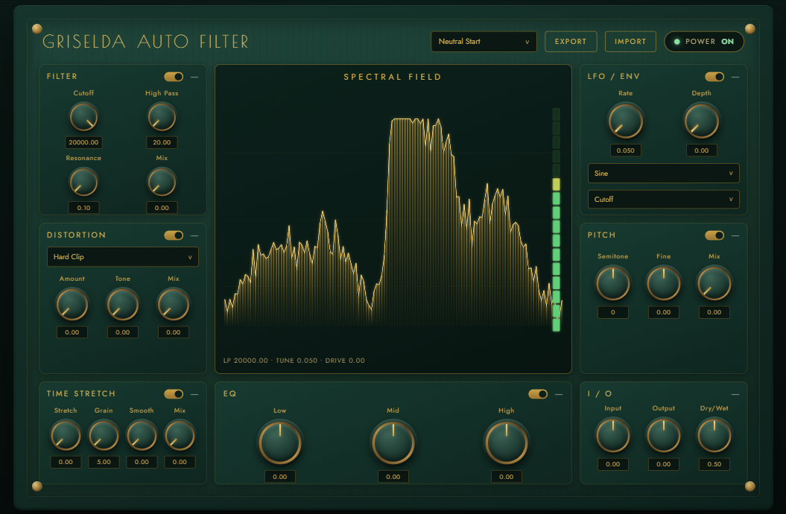
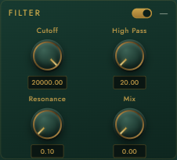
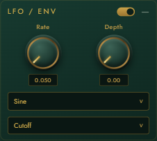
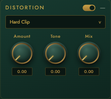
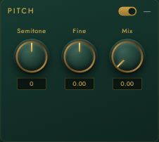
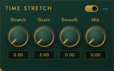
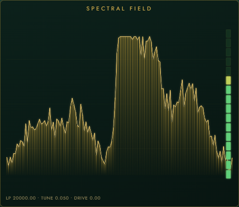

<p align="center">
  
</p>

<p align="center"><b>A lo-fi auto-filter for hip-hop production, as VST3 and standalone for Windows</b><br>
filter, EQ, LFO and envelope, four kinds of distortion, pitch and grain time stretch in one dark green box</p>

<p align="center">
  <a href="https://github.com/sog-maker/griselda-auto-filter-plugin/releases/latest"></a>
  <a href="LICENSE"></a>
  
  
</p>

<p align="center"><b>New in 2.2.3:</b> the first public release, with the WebView interface, five factory presets and preset export and import ·
<a href="https://github.com/sog-maker/griselda-auto-filter-plugin/releases/tag/v2.2.3">the release notes</a></p>

<p align="center"><b>New to Griselda?</b> Read the <a href="docs/manual/GUIDE.md">user guide</a> and the
<a href="INSTALL.md">install guide</a>.<br>
<b>Deutsch:</b> <a href="README.de.md">README auf Deutsch</a></p>



Griselda Auto Filter is an effect for dusty loops, dark samples and moving basslines. A resonant low-pass and high-pass
filter sits at its core. An LFO and an envelope follower move the cutoff, the resonance, the pitch or the drive. After
the filter come a three-band EQ, four kinds of distortion with a tone control, a pitch shifter and a grain time stretch,
each with its own mix knob and its own on switch. A spectral field shows what comes in.

It is built with [JUCE 8](https://juce.com). The interface is written in React and runs in Microsoft WebView2 inside
the plug-in window. Please report bugs and ideas [here](https://github.com/sog-maker/griselda-auto-filter-plugin/issues).

## Install

1. Download the Windows zip from the [latest release](https://github.com/sog-maker/griselda-auto-filter-plugin/releases/latest)
   and unpack it.
2. Close your DAW.
3. Copy `Griselda Auto Filter.vst3` to `C:\Program Files\Common Files\VST3` (this needs administrator rights).
4. Start the DAW, let it scan for new plug-ins, and load **Griselda Auto Filter** on a track.

**Standalone:** start `Griselda Auto Filter.exe` and pick the audio device under *Options*.

**For a sharp picture in Ableton Live:** right-click the title bar of the device, turn off
**Auto-Scale Plug-in Window**, and load the plug-in again.

**WebView2:** the interface needs the Microsoft Edge WebView2 Runtime. Windows 11 has it; on Windows 10 install it from
[Microsoft](https://developer.microsoft.com/microsoft-edge/webview2/) if the window stays empty.

**Uninstall:** delete `Griselda Auto Filter.vst3` from the VST3 folder.

Step by step: [INSTALL.md](INSTALL.md) · [Deutsch](INSTALL.de.md).

## At a glance

| | |
| --- | --- |
| **Formats** | VST3, standalone application |
| **Platform** | Windows 10 and 11, x64 (macOS builds from source, untested) |
| **Tested in** | Ableton Live 12 |
| **Signal path** | input → filter → EQ → distortion → pitch → time stretch → output, then dry/wet |
| **Filter** | low-pass 20 Hz to 20 kHz, high-pass 20 Hz to 1.5 kHz, resonance, mix |
| **Modulation** | LFO with five shapes and four targets, envelope follower on the cutoff |
| **Distortion** | soft clip, hard clip, tube, foldback; amount, tone, mix |
| **Pitch** | ±24 semitones, ±100 cents, mix |
| **Time stretch** | two overlapping grains, 5 to 250 ms, smooth, mix |
| **EQ** | low shelf, mid peak, high shelf, ±12 dB |
| **Presets** | five factory presets, export and import as XML |
| **Window** | 704 × 461 points, fixed size |
| **Automation** | every parameter, including some that are not on the panel |

## A tour

### Shape the sound with the filter

<table>
<tr>
<td width="40%"><br><sub><b>FILTER</b>: low-pass, high-pass, resonance, mix</sub></td>
<td>

1. **Cutoff** closes the low-pass filter from 20 kHz down to 20 Hz.
2. **High Pass** cuts the lows, from 20 Hz up to 1.5 kHz.
3. **Resonance** lifts the frequencies around the cutoff.
4. **Mix** blends the filtered signal with the unfiltered one. At 0 the filter is not heard.
5. The **switch** in the header turns the section on and off.

</td>
</tr>
</table>

### Make it move

<table>
<tr>
<td width="40%"><br><sub><b>LFO / ENV</b>: rate, depth, shape, target</sub></td>
<td>

1. **Rate** sets the speed of the LFO, from 0.05 Hz to 20 Hz.
2. **Depth** sets how far it moves the target.
3. Click the **shape** box to step through sine, triangle, saw, square and random.
4. Click the **target** box to pick cutoff, resonance, pitch or distortion.
5. The envelope follower opens the cutoff with the level of the input. Its amount, attack, release and sensitivity
   are automation parameters in your DAW.

</td>
</tr>
</table>

### Add dirt

<table>
<tr>
<td width="40%"><br><sub><b>DISTORTION</b>: type, amount, tone, mix</sub></td>
<td>

1. Click the **type** box to choose soft clip, hard clip, tube or foldback.
2. **Amount** drives the signal into the distortion.
3. **Tone** opens a low-pass after the distortion, from dark (700 Hz) to bright (14 kHz).
4. **Mix** blends it with the clean one.

</td>
</tr>
</table>

### Bend the pitch

<table>
<tr>
<td width="40%"><br><sub><b>PITCH</b>: semitone, fine, mix</sub></td>
<td>

1. **Semitone** shifts the pitch by up to two octaves up or down.
2. **Fine** detunes by up to 100 cents.
3. **Mix** blends the shifted signal with the original. A low mix gives a thick, detuned layer.

</td>
</tr>
</table>

### Smear time

<table>
<tr>
<td width="40%"><br><sub><b>TIME STRETCH</b>: stretch, grain, smooth, mix</sub></td>
<td>

1. **Stretch** reads small pieces of the recent past at a slower speed.
2. **Grain** sets the length of the pieces, from 5 to 250 ms.
3. **Smooth** makes the grains overlap more and softens the result.
4. **Mix** blends the texture with the signal.

</td>
</tr>
</table>

### Watch, balance, save

<table>
<tr>
<td width="40%"><br><sub><b>SPECTRAL FIELD</b>: the spectrum of the input and a level meter</sub></td>
<td>

1. The **spectral field** shows the spectrum of the input and a level meter. Without a signal it plays a calm
   example curve.
2. **EQ**: **Low**, **Mid** and **High** cut or boost by up to 12 dB.
3. **I/O**: **Input** and **Output** trim the level by up to 24 dB, **Dry/Wet** blends the whole effect with the
   dry signal.
4. Click the **preset** box to step through the factory presets. **EXPORT** saves the current settings as an XML
   file, **IMPORT** loads one.
5. **POWER** bypasses the whole plug-in.

</td>
</tr>
</table>

## Controls

| Control | What it does |
| --- | --- |
| Drag a knob up or down | changes its value |
| Click a box with ∨ | steps to the next choice |
| Switch in a section header | turns the section on or off; an off section is dimmed |
| **POWER** | bypasses the plug-in |
| **EXPORT** / **IMPORT** | saves or loads all settings as an XML file |
| DAW automation | every parameter, also filter slope (12, 24, 48 dB), LFO sync and the envelope follower |

## Documentation

| | English | Deutsch |
| --- | --- | --- |
| User guide | [GUIDE.md](docs/manual/GUIDE.md) | [GUIDE.de.md](docs/manual/GUIDE.de.md) |
| Install | [INSTALL.md](INSTALL.md) | [INSTALL.de.md](INSTALL.de.md) |
| Build from source | [BUILD.md](docs/developer/BUILD.md) | [BUILD.de.md](docs/developer/BUILD.de.md) |
| Changes | [CHANGELOG.md](CHANGELOG.md) | |
| Third-party licences | [THIRD_PARTY_LICENSES.md](THIRD_PARTY_LICENSES.md) | |

## Build from source

You need Visual Studio 2022 (or the Build Tools) with C++, CMake 3.22 or newer, Ninja, Node.js with pnpm 10, JUCE 8.0.13
and the WebView2 SDK.

```powershell
git clone https://github.com/sog-maker/griselda-auto-filter-plugin.git
cd griselda-auto-filter-plugin
git clone --depth 1 --branch 8.0.13 https://github.com/juce-framework/JUCE.git JUCE
powershell -ExecutionPolicy Bypass -File .\rebuild.ps1
```

The details, the WebView2 SDK and macOS: [docs/developer/BUILD.md](docs/developer/BUILD.md).

## If the plug-in does not show up

- **Not in the plug-in list:** check that the whole `Griselda Auto Filter.vst3` folder is in
  `C:\Program Files\Common Files\VST3`, and rescan the plug-ins in your DAW.
- **The window stays empty or black:** install the Microsoft Edge WebView2 Runtime and load the plug-in again.
- **The picture is blurry in Live:** turn off **Auto-Scale Plug-in Window** for the device.
- **No sound:** check that **POWER** is on, that **Dry/Wet** is not at 0 and that **Output** is not turned down.

## Support

Bugs and ideas: [open an issue](https://github.com/sog-maker/griselda-auto-filter-plugin/issues). Please name your
Windows version, your DAW and its version, and what you did before it happened.

## Credits

- **[JUCE](https://juce.com)** by Raw Material Software: the plug-in framework, the DSP building blocks and the WebView
  host
- **[VST3 SDK](https://github.com/steinbergmedia/vst3sdk)** by Steinberg Media Technologies: the VST3 format
- **[Microsoft Edge WebView2](https://developer.microsoft.com/microsoft-edge/webview2/)** by Microsoft: the browser that
  draws the interface
- **[React](https://react.dev)** by Meta and the community: the interface
- **[Vite](https://vite.dev)**, **[Tailwind CSS](https://tailwindcss.com)** and
  **[tw-animate-css](https://github.com/Wombosvideo/tw-animate-css)**: building and styling the interface
- **[shadcn/ui](https://ui.shadcn.com)**: the base theme tokens in `ui/src/styles/theme.css`
- **[Jost](https://github.com/indestructible-type/Jost)** by Indestructible Type and
  **[Poiret One](https://github.com/alexeiva/poiretone)** by Denis Masharov: the fonts
- **[pluginval](https://github.com/Tracktion/pluginval)** by Tracktion: plug-in validation
- **[Griselda Records](https://en.wikipedia.org/wiki/Griselda_Records)** from Buffalo, New York: their dark, gritty
  sound was the inspiration for the sound of this plug-in, its name and its look

## Licence

Free software: you can use, study, share and change it under the
[GNU Affero General Public License, version 3 only](LICENSE) (AGPL-3.0-only). Third-party components keep their own
licences, listed in [THIRD_PARTY_LICENSES.md](THIRD_PARTY_LICENSES.md). VST is a registered trademark of Steinberg Media
Technologies GmbH. Griselda Auto Filter is not affiliated with Griselda Records.

Copyright (C) 2026 Schlensog Audio Lab (Griselda Auto Filter)
