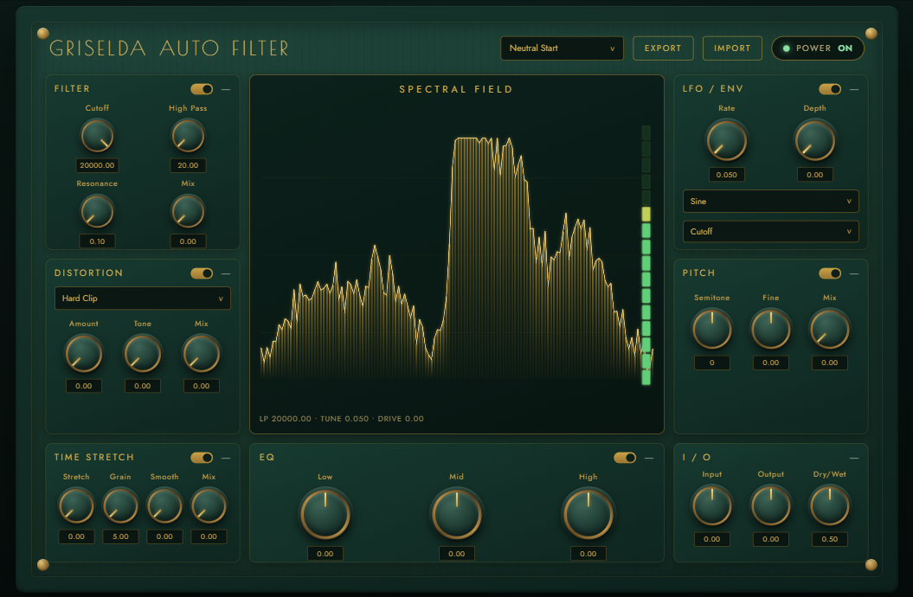

# Griselda Auto Filter: Anleitung

Version 2.2.3 · [English](GUIDE.md)



## Wie der Klang fließt

```
Input-Gain → Filter → EQ → Distortion → Pitch → Time Stretch → Output-Gain → Dry/Wet
               ↑                ↑          ↑
              LFO und Hüllkurvenfolger (jeweils ein Ziel)
```

Jeder Bereich hat im Kopf einen Schalter. Ein ausgeschalteter Bereich ist abgedunkelt und lässt das Signal unverändert
durch. **Dry/Wet** am Ende mischt die ganze Kette mit dem trockenen Eingang.

## Bedienung

- **Regler:** drücken und nach oben oder unten ziehen. Der Wert steht im Feld unter dem Regler.
- **Felder mit ∨:** klicken, um zur nächsten Auswahl zu wechseln.
- **Bereichsschalter:** klicken, um den Bereich ein- oder auszuschalten.
- **POWER:** Bypass für das ganze Plug-in. Aus dunkelt die Oberfläche ab.
- **Presetfeld:** klicken, um durch die fünf Werks-Presets zu wechseln.
- **EXPORT:** speichert alle Einstellungen in eine XML-Datei deiner Wahl.
- **IMPORT:** lädt Einstellungen aus so einer Datei.

Die DAW speichert alle Einstellungen mit dem Projekt.

## Die Bereiche

### Filter

| Regler | Bereich | Start | Was er tut |
| --- | --- | --- | --- |
| Cutoff | 20 Hz bis 20 kHz | 20 kHz | die Tiefpassfrequenz |
| High Pass | 20 Hz bis 1,5 kHz | 20 Hz | die Hochpassfrequenz |
| Resonance | 0,10 bis 1,00 | 0,10 | die Überhöhung um den Cutoff |
| Mix | 0 bis 100 % | 0 % | gefiltertes gegen ungefiltertes Signal |

Die Steilheit des Filters (12, 24 oder 48 dB pro Oktave, Start 24 dB) ist der Automationsparameter *Filter Slope*.

### LFO / ENV

| Regler | Bereich | Start | Was er tut |
| --- | --- | --- | --- |
| Rate | 0,05 bis 20 Hz | 0,05 Hz | das Tempo des LFO |
| Depth | 0 bis 100 % | 0 % | wie weit der LFO sein Ziel bewegt |
| Form | Sinus, Dreieck, Sägezahn, Rechteck, Zufall | Sinus | die Wellenform |
| Ziel | Cutoff, Resonanz, Pitch, Distortion | Cutoff | was der LFO bewegt |

So weit reicht der LFO bei voller Tiefe: Cutoff bis ±1,75 Oktaven, Resonanz ±0,45, Pitch ±12 Halbtöne,
Distortion-Amount ±45 %.

**LFO Sync** (nur Automation): Mit Sync wählt **Rate** eine Notenlänge, die dem Tempo der DAW folgt: ganze Note, 1/2,
1/4, 1/8, 1/16, 1/32, Achteltriole oder Sechzehnteltriole.

**Hüllkurvenfolger** (nur Automation): Er folgt dem Pegel des Eingangs und öffnet den Tiefpass-Cutoff um bis zu zwei
Oktaven.

| Parameter | Bereich | Start |
| --- | --- | --- |
| Envelope Amount | 0 bis 100 % | 0 % |
| Envelope Attack | 1 bis 300 ms | 20 ms |
| Envelope Release | 5 bis 1000 ms | 220 ms |
| Envelope Sensitivity | 0 bis 100 % | 80 % |

Der Bereichsschalter schaltet LFO und Hüllkurvenfolger gemeinsam aus.

### Distortion

| Regler | Bereich | Start | Was er tut |
| --- | --- | --- | --- |
| Art | Soft Clip, Hard Clip, Tube, Foldback | Hard Clip | der Charakter |
| Amount | 0 bis 100 % | 0 % | wie stark das Signal angetrieben wird |
| Tone | 0 bis 100 % | 0 % | ein Tiefpass hinter der Verzerrung, 700 Hz bis 14 kHz |
| Mix | 0 bis 100 % | 0 % | verzerrtes gegen sauberes Signal |

- **Soft Clip:** rund und warm.
- **Hard Clip:** flache Spitzen, mehr Biss.
- **Tube:** weiche Sättigung, die nie ganz flach wird; ein Teil des sauberen Signals bleibt.
- **Foldback:** laute Stellen falten zurück; metallisch und wild.

### Pitch

| Regler | Bereich | Start | Was er tut |
| --- | --- | --- | --- |
| Semitone | −24 bis +24 | 0 | die Verschiebung in Halbtönen |
| Fine | −100 bis +100 Cent | 0 | Feinstimmung |
| Mix | 0 bis 100 % | 0 % | verschobenes gegen ursprüngliches Signal |

### Time Stretch

| Regler | Bereich | Start | Was er tut |
| --- | --- | --- | --- |
| Stretch | 0 bis 100 % | 0 % | wie langsam die Grains die jüngste Vergangenheit lesen |
| Grain | 5 bis 250 ms | 5 ms | die Länge eines Grains |
| Smooth | 0 bis 100 % | 0 % | mehr Überlappung, weniger Zittern, weichere Höhen |
| Mix | 0 bis 100 % | 0 % | Textur gegen Signal |

Zwei Grains, um ein halbes Grain versetzt, lesen kleine Stücke aus den letzten Momenten des Signals. Kurze Grains
klingen körnig und surrend, lange wie ein Band, das schleift.

### EQ

| Regler | Bereich | Start | Band |
| --- | --- | --- | --- |
| Low | −12 bis +12 dB | 0 dB | Low Shelf bei 200 Hz |
| Mid | −12 bis +12 dB | 0 dB | Peak bei 1 kHz |
| High | −12 bis +12 dB | 0 dB | High Shelf bei 5,2 kHz |

Frequenz und Güte jedes Bandes sind Automationsparameter (*Low/Mid/High Frequency*, *Low/Mid/High Q*).

### I/O

| Regler | Bereich | Start | Was er tut |
| --- | --- | --- | --- |
| Input | −24 bis +24 dB | 0 dB | der Pegel in die Kette |
| Output | −24 bis +24 dB | 0 dB | der Pegel aus der Kette |
| Dry/Wet | 0 bis 100 % | 50 % | der ganze Effekt gegen den trockenen Eingang |

### Spectral Field

Das Spektralfeld zeigt das Spektrum des Eingangs nach dem Input-Gain und rechts eine Pegelanzeige. Die Zeile unten
zeigt Cutoff, LFO-Rate und Distortion-Amount. Ohne Signal zeigt es eine ruhige Beispielkurve.

## Werks-Presets

| Preset | Idee |
| --- | --- |
| **Neutral Start** | alles zurück auf die Startwerte; ein sauberer Anfang |
| **Wobble Trap** | ein resonanter Tiefpass bei 950 Hz, bewegt von einem schnellen LFO, etwas Hard Clip, eine Schicht sieben Halbtöne tiefer |
| **Dust Loop** | ein dunkler Filter, kräftiger Hard Clip, warmer EQ und eine körnige Time-Stretch-Schicht |
| **Tape Grinder** | ein geschlossener Filter bei 1,8 kHz und schwere, dunkle Verzerrung |
| **Smoked Vinyl** | ein weicher Filter, etwas mehr Mitten, matte Höhen und lange, weiche Grains |

Ein Preset ändert nur die Werte, die es nennt. Für ein sauberes Ergebnis zuerst **Neutral Start** wählen.

## Tipps

- Den **Mix** eines Bereichs bei 0 beginnen und aufdrehen, bis man ihn hört.
- Für einen klassischen Filter-Sweep: **Filter Mix** auf 100 %, **Resonance** um 0,6, LFO-Ziel **Cutoff**, dann mit
  **Rate** und **Depth** spielen.
- Für Lo-Fi-Drums: **Cutoff** um 4 kHz, **Distortion** Soft Clip mit wenig **Amount**, ein kurzes **Grain** mit etwas
  **Stretch** und wenig **Mix**.
- **Dry/Wet** startet bei 50 %. Auf 100 % drehen, um nur den Effekt zu hören.
