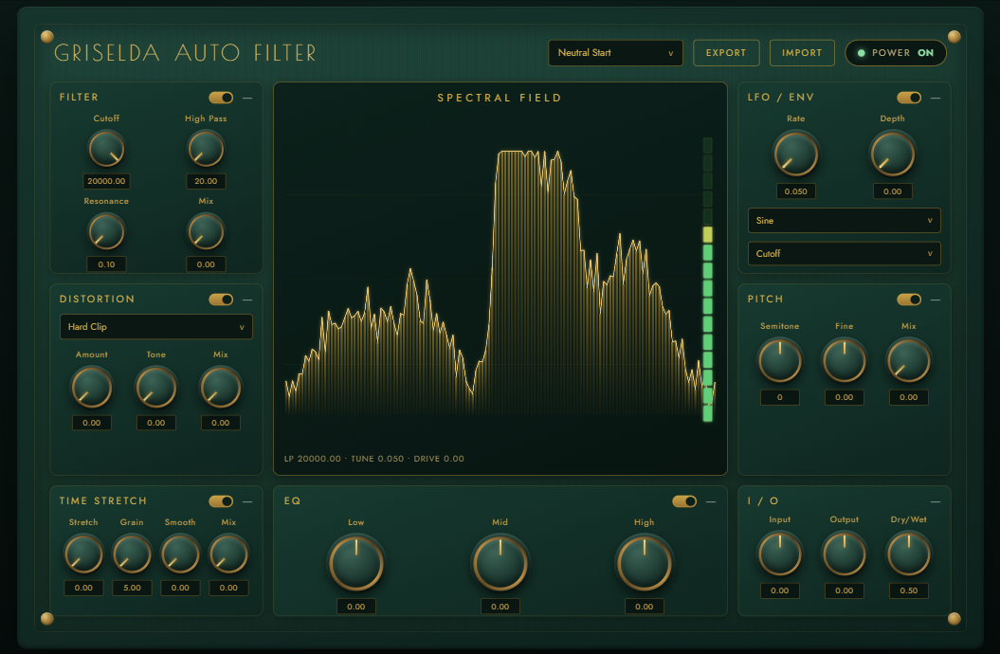

# Griselda Auto Filter: user guide

Version 2.2.3 · [Deutsch](GUIDE.de.md)



## How the sound flows

```
input gain → filter → EQ → distortion → pitch → time stretch → output gain → dry/wet
                ↑                ↑           ↑
               LFO and envelope follower (one target at a time)
```

Every section has a switch in its header. A section that is off is dimmed and lets the signal through untouched.
**Dry/Wet** at the end blends the whole chain with the dry input.

## Working the panel

- **Knobs:** press and drag up or down. The value shows in the box under the knob.
- **Boxes with ∨:** click to step to the next choice.
- **Section switches:** click to turn the section on or off.
- **POWER:** bypasses the whole plug-in. Off dims the panel.
- **Preset box:** click to step through the five factory presets.
- **EXPORT:** saves all settings to an XML file of your choice.
- **IMPORT:** loads settings from such a file.

Your DAW saves all settings with the project.

## The sections

### Filter

| Control | Range | Start | What it does |
| --- | --- | --- | --- |
| Cutoff | 20 Hz to 20 kHz | 20 kHz | the low-pass frequency |
| High Pass | 20 Hz to 1.5 kHz | 20 Hz | the high-pass frequency |
| Resonance | 0.10 to 1.00 | 0.10 | the peak around the cutoff |
| Mix | 0 to 100 % | 0 % | filtered against unfiltered signal |

The steepness of the filter (12, 24 or 48 dB per octave, start 24 dB) is the automation parameter *Filter Slope*.

### LFO / ENV

| Control | Range | Start | What it does |
| --- | --- | --- | --- |
| Rate | 0.05 to 20 Hz | 0.05 Hz | the speed of the LFO |
| Depth | 0 to 100 % | 0 % | how far the LFO moves its target |
| Shape | sine, triangle, saw, square, random | sine | the wave |
| Target | cutoff, resonance, pitch, distortion | cutoff | what the LFO moves |

How far the LFO reaches at full depth: cutoff up to ±1.75 octaves, resonance ±0.45, pitch ±12 semitones, distortion
amount ±45 %.

**LFO Sync** (automation only): with sync on, **Rate** picks a note length that follows the tempo of your DAW: a whole
note, 1/2, 1/4, 1/8, 1/16, 1/32, 1/8 triplet or 1/16 triplet.

**Envelope follower** (automation only): it follows the level of the input and opens the low-pass cutoff by up to two
octaves.

| Parameter | Range | Start |
| --- | --- | --- |
| Envelope Amount | 0 to 100 % | 0 % |
| Envelope Attack | 1 to 300 ms | 20 ms |
| Envelope Release | 5 to 1000 ms | 220 ms |
| Envelope Sensitivity | 0 to 100 % | 80 % |

The section switch turns the LFO and the envelope follower off together.

### Distortion

| Control | Range | Start | What it does |
| --- | --- | --- | --- |
| Type | soft clip, hard clip, tube, foldback | hard clip | the character |
| Amount | 0 to 100 % | 0 % | how hard the signal is driven |
| Tone | 0 to 100 % | 0 % | a low-pass after the distortion, 700 Hz to 14 kHz |
| Mix | 0 to 100 % | 0 % | distorted against clean signal |

- **Soft clip:** round and warm.
- **Hard clip:** flat tops, more edge.
- **Tube:** smooth saturation that never goes quite flat; it keeps some of the clean signal.
- **Foldback:** loud parts fold back down; metallic and wild.

### Pitch

| Control | Range | Start | What it does |
| --- | --- | --- | --- |
| Semitone | −24 to +24 | 0 | the shift in semitones |
| Fine | −100 to +100 cents | 0 | fine tuning |
| Mix | 0 to 100 % | 0 % | shifted against original signal |

### Time stretch

| Control | Range | Start | What it does |
| --- | --- | --- | --- |
| Stretch | 0 to 100 % | 0 % | how slowly the grains read the recent past |
| Grain | 5 to 250 ms | 5 ms | the length of a grain |
| Smooth | 0 to 100 % | 0 % | more overlap, less jitter, softer highs |
| Mix | 0 to 100 % | 0 % | texture against signal |

Two grains, half a grain apart, read small pieces from the last moments of the signal. Short grains sound grainy and
buzzing, long grains sound like a tape that drags.

### EQ

| Control | Range | Start | Band |
| --- | --- | --- | --- |
| Low | −12 to +12 dB | 0 dB | low shelf at 200 Hz |
| Mid | −12 to +12 dB | 0 dB | peak at 1 kHz |
| High | −12 to +12 dB | 0 dB | high shelf at 5.2 kHz |

The frequency and the Q of each band are automation parameters (*Low/Mid/High Frequency*, *Low/Mid/High Q*).

### I/O

| Control | Range | Start | What it does |
| --- | --- | --- | --- |
| Input | −24 to +24 dB | 0 dB | the level into the chain |
| Output | −24 to +24 dB | 0 dB | the level out of the chain |
| Dry/Wet | 0 to 100 % | 50 % | the whole effect against the dry input |

### Spectral field

The spectral field shows the spectrum of the input, after the input gain, and a level meter on the right. The line at
the bottom shows the cutoff, the LFO rate and the distortion amount. Without a signal it plays a calm example curve.

## Factory presets

| Preset | Idea |
| --- | --- |
| **Neutral Start** | everything back to the start values; a clean place to begin |
| **Wobble Trap** | a resonant low-pass at 950 Hz moved by a fast LFO, some hard clip, a layer seven semitones down |
| **Dust Loop** | a dark filter, strong hard clip, warm EQ and a grainy time-stretch layer |
| **Tape Grinder** | a closed filter at 1.8 kHz and heavy, dark distortion |
| **Smoked Vinyl** | a soft filter, a little mid lift, dull highs and long, smooth grains |

A preset changes only the values it names. Choose **Neutral Start** first for a clean result.

## Tips

- Start with **Mix** of a section at 0 and turn it up until you hear it.
- For a classic filter sweep: **Filter Mix** at 100 %, **Resonance** around 0.6, LFO target **Cutoff**, then play with
  **Rate** and **Depth**.
- For lo-fi drums: **Cutoff** around 4 kHz, **Distortion** soft clip with a little **Amount**, a short **Grain** with
  some **Stretch** and a low **Mix**.
- **Dry/Wet** starts at 50 %. Turn it to 100 % to hear only the effect.
